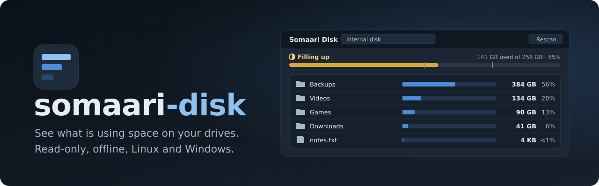
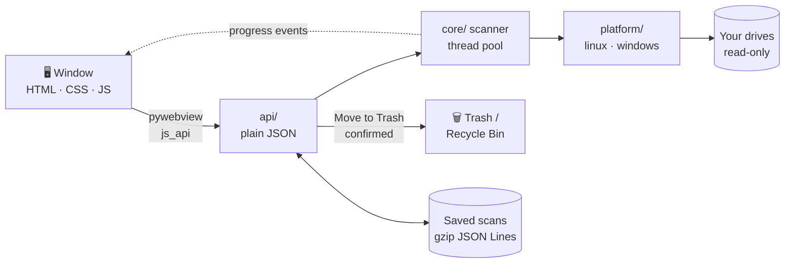

<div align="center">



<br>

**Find what is filling your drives, and clear it out safely.**<br>
Somaari Disk scans a drive or folder and shows the largest items first, with a usage bar, folder
totals and file details. Internal disks and external drives alike: USB sticks, SD cards, NVMe,
exFAT/NTFS/FAT32, read-only mounts.

<br>

[](CHANGELOG.md)
[](https://www.python.org/)
[](https://pywebview.flowrl.com/)
[](docs/GUIDE.md#debian-ubuntu-raspberry-pi-os-deb)
[](docs/GUIDE.md#windows-installer-or-zip)
[](https://www.raspberrypi.com/products/raspberry-pi-5/)
[](LICENSE)

[Features](#-features) ·
[Install](#-install) ·
[Usage](#-usage) ·
[How it works](#-how-it-works) ·
[Privacy](#-privacy) ·
[Safety](#%EF%B8%8F-safety-model) ·
[Development](#%EF%B8%8F-development) ·
[Guide](docs/GUIDE.md)

</div>


> [!NOTE]
> Reads only. The one change it can make is **Move to Trash**, after you confirm, and the Trash
> restores it. No network access, no telemetry, no accounts.

---

## ✨ Features

- 📊 **Largest first**: every folder's contents sorted by size, with a bar and share, so the big
  items are always at the top. Drill in with a double-click, back with Backspace.
- 💽 **Every drive**: internal disks, USB sticks and drives, SD cards, NVMe, network shares;
  exFAT, NTFS, FAT32, ext4 and read-only mounts. Plug a drive in and it appears within seconds.
- 🚦 **Usage at a glance**: *Plenty of space*, *Filling up*, *Running low* or *Disk full*, with an
  icon and label, not just a colour.
- 🗑️ **Move to Trash, never delete**: one file, a folder, or many at once, with one confirmation.
  Totals update without a rescan.
- ⚡ **Fast and frugal**: scans run in the background, fill the list as they go, can be stopped,
  and skip folders they can't read. A generated million-file tree scans in about 9 seconds on a
  Raspberry Pi 5.
- 💾 **Opens instantly**: the last scan of each location is saved, even for a drive you unplug
  and plug back in. Rescan when you want fresh numbers.
- 🧭 **Honest numbers**: never follows symlinks or junctions, stays on one drive, counts hard
  links once, and shows size on disk too.
- ⌨️ **Keyboard first**: everything, including multi-select and the Trash dialog, works without a
  mouse.
- 🌗 **Light and dark**: follows your OS, or pick one.

Runs on Linux (tested on Raspberry Pi 5, arm64) and Windows 10/11 (x64).

## 🚀 Install

Download from [Releases](https://github.com/ashwinkrpi/somaari-disk/releases): a `.deb` for
Debian, Ubuntu and Raspberry Pi OS (arm64 and x86-64), or a Windows installer / portable zip.

```sh
sudo apt install ./somaari-disk_<version>_all.deb    # then open Somaari Disk from the app menu
```

The [guide](docs/GUIDE.md) covers the rest:
- [Requirements](docs/GUIDE.md#requirements),
  [Windows](docs/GUIDE.md#windows-installer-or-zip) (SmartScreen, WebView2) and
  [checking downloads](docs/GUIDE.md#checking-downloads) against `SHA256SUMS`
- From source on [other Linux distributions](docs/GUIDE.md#from-source-on-linux) and
  [Windows](docs/GUIDE.md#from-source-on-windows)
- [Updating](docs/GUIDE.md#updating), [trying it with demo data](docs/GUIDE.md#try-it-with-demo-data)
  and [uninstalling](docs/GUIDE.md#uninstalling)
- [Configuration](docs/GUIDE.md#%EF%B8%8F-configuration): theme, window size, where the app keeps
  its files, command line

## 🧑‍💻 Usage

| Do this… | What happens |
|---|---|
| Pick a drive in **Location** | Its saved scan opens at once, or a new scan starts and the list fills in |
| Double-click a folder (or **Enter**) | Opens it; **Backspace** or **Up** goes back |
| Click a file | Type, size, size on disk, dates, owner and full path on the right |
| **Show in folder** | Opens your file manager at that item |
| **Shift+click** / **Ctrl+click** | Selects several items; the panel shows their total |
| **Delete** or **Move to Trash** | Asks first, then moves them to the Trash or Recycle Bin |
| **Rescan** (F5) / **Stop** (Esc) | Scans fresh / stops a running scan |
| `somaari-disk scan <folder>` | The largest items in the terminal, no window |

Everything else, with screenshots and every keyboard shortcut:
[Using the app](docs/GUIDE.md#-using-the-app).

## 🧠 How it works



<details>
<summary><b>Step by step</b></summary>

<br>

One Python process and one window: no server, no database, no Node, no build step.
1. **Window**: pywebview with GTK + WebKitGTK on Linux and Edge WebView2 on Windows, showing
   static HTML/CSS/JS from the package. The page has no OS access; it only calls `api/`.
2. **api/** turns each request into plain JSON (errors included, never exceptions) and pushes
   progress to the page as events.
3. **core/** scans with a small thread pool, adds sizes up the tree as each folder is listed (so
   the list can fill in mid-scan), and keeps the tree compact: about 250 to 300 bytes per file.
4. **platform/** is the only code that touches the OS: drive lists (psutil and `lsblk` on Linux,
   Win32 calls on Windows), size on disk, owners, Show in folder and the Trash (send2trash).
5. **Saved scans** are streamed to gzip JSON Lines, one file per location, so a million-file tree
   never sits in memory twice.

</details>

## 🔒 Privacy

> [!IMPORTANT]
> **TL;DR:** nothing leaves your computer. The app makes no network requests, has no telemetry,
> and needs no account.

<details>
<summary><b>What it stores, and where</b></summary>

<br>

- **Settings**: theme and window size, in your user config folder.
- **Saved scans**: the last scan of up to 8 locations, in your user cache folder. They contain
  file names, so on Linux the folder is readable only by you. Delete it any time.
- **Log**: counts, timings and error codes, never file names; your home folder is written as `~`.
  At most 4 files of 512 KiB.
- **The page** has a strict Content Security Policy: it loads only its own bundled files and
  fonts, nothing from the internet.

Exact paths: [Where the app keeps its files](docs/GUIDE.md#where-the-app-keeps-its-files).

</details>

## 🛡️ Safety model

| Rule | What it means |
|---|---|
| 👀 **Read-only** | Scanning never changes anything. The only write to your files is Move to Trash |
| ✋ **Always asks** | Move to Trash needs a confirmation that names the items and their size; Cancel is the default |
| ♻️ **No permanent delete** | Items go to the Trash or Recycle Bin and can be restored from there |
| 🚧 **Stays in bounds** | Never follows symlinks or junctions, never crosses into another drive, refuses to trash a folder that holds another drive |

<details>
<summary><b>Details</b></summary>

<br>

- The page can only call the listed `api/` methods; it has no file or OS access of its own, and
  file names are always shown as text, never as HTML.
- Move to Trash refuses read-only drives and the scanned location itself, and checks the drive
  again just before moving. Failures come back in plain words (no permission, no Trash on that
  drive, drive unplugged, already gone).
- Scans never crash on unreadable folders, vanished files or unplugged drives; they skip and
  carry on, or stop with *Drive disconnected*.
- Builds are not code signed yet. Download only from Releases and check `SHA256SUMS`. Report
  security problems privately: [SECURITY.md](SECURITY.md).

</details>

## 🛠️ Development

```sh
python3 -m venv --system-site-packages .venv   # Linux: PyGObject comes from apt
.venv/bin/pip install -e ".[dev]"
.venv/bin/python -m somaari_disk --demo        # the window on generated sample drives
.venv/bin/pytest -q                            # fake platform only: never real drives or windows
.venv/bin/ruff check . && .venv/bin/ruff format .
scripts/ship.py                                # push: bumps the patch version, commits, pushes
scripts/ship.py major                          # or minor, major, or an exact X.Y.Z
```

On Linux install the system packages first ([From source on Linux](docs/GUIDE.md#from-source-on-linux)).
See [CONTRIBUTING.md](CONTRIBUTING.md), [docs/ARCHITECTURE.md](docs/ARCHITECTURE.md) and
[docs/TESTING.md](docs/TESTING.md). Screenshots come from `--demo` only, never real files.

## License

MIT, see [LICENSE](LICENSE). Bundled fonts and dependencies: [THIRD-PARTY-NOTICES.md](THIRD-PARTY-NOTICES.md).

<div align="center">
<br>
<sub>Made for a Raspberry Pi 5 with a small SD card and a lot of files.</sub>
</div>
