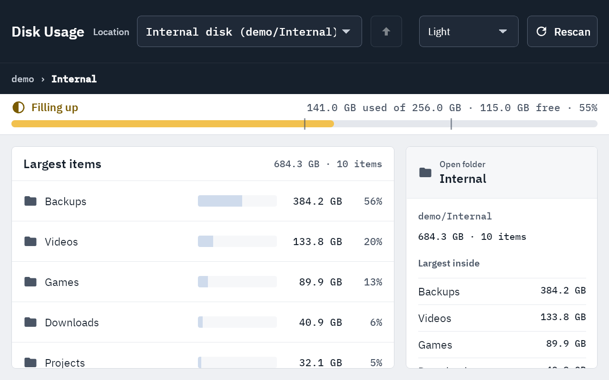
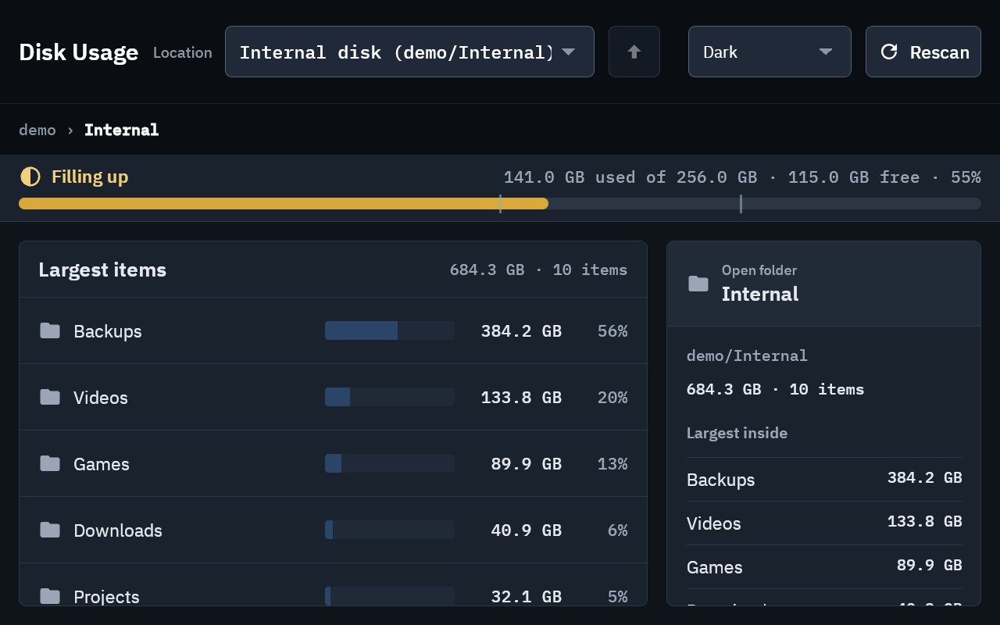

# somaari-disk

See what is using space on your drives. Somaari Disk scans a drive or folder and shows the
largest items first, with a usage bar, folder totals and file details. It works on internal
disks and external drives (USB sticks, SD cards, NVMe, exFAT/NTFS/FAT32, read-only mounts).




*Screenshots use the built-in demo tree, not real files.*

## What it does and does not do

- Reads only. The one change it can make is **Move to Trash**, after you confirm. There is no
  permanent delete; restore from the system Trash or Recycle Bin.
- No network access, no telemetry, no accounts.
- Never follows symlinks or junctions, stays on one drive, counts hard links once.
- Scans run in the background, can be stopped, and skip folders it cannot read.
- Remembers the last scan of each location so it opens instantly; Rescan scans fresh.
- Light and dark themes (follows the OS, or pick one).

Runs on Linux (tested on Raspberry Pi 5, arm64) and Windows 10/11 (x64).

## Install

Download from [Releases](https://github.com/ashwinkrpi/somaari-disk/releases):

- **Debian, Ubuntu, Raspberry Pi OS** (arm64 and x86-64): `somaari-disk_<version>_all.deb`

  ```sh
  sudo apt install ./somaari-disk_<version>_all.deb
  ```

  Needs Python 3.11+ (Debian 12, Ubuntu 23.04 or newer). Then open **Somaari Disk** from the
  app menu, or run `somaari-disk`.
- **Windows 10/11 x64**: `somaari-disk-<version>-setup.exe` (installs for your user, no admin),
  or the portable `somaari-disk-<version>-windows-x64.zip`. Needs the Microsoft Edge WebView2
  Runtime, which Windows 11 includes; the app tells you if it is missing. Builds are not code
  signed yet, so SmartScreen may warn: choose **More info**, then **Run anyway**.

Check downloads against `SHA256SUMS` from the same release.

Other Linux distributions, or running from source: see [INSTALL.md](INSTALL.md).

## Use

```sh
somaari-disk            # open the window
somaari-disk --demo     # try it on a generated sample tree
somaari-disk scan PATH  # text report, no window
somaari-disk volumes    # list drives
```

Keyboard: arrows, Home/End, PgUp/PgDn to move; Enter opens a folder; Backspace goes up;
Delete moves the selected file to Trash (asks first).

## Develop

```sh
python3 -m venv --system-site-packages .venv
.venv/bin/pip install -e ".[dev]"
.venv/bin/pytest -q
.venv/bin/ruff check . && .venv/bin/ruff format .
```

See [CONTRIBUTING.md](CONTRIBUTING.md), [docs/ARCHITECTURE.md](docs/ARCHITECTURE.md) and
[docs/TESTING.md](docs/TESTING.md). Security issues: [SECURITY.md](SECURITY.md).

## License

MIT, see [LICENSE](LICENSE). Bundled fonts and dependencies: [THIRD-PARTY-NOTICES.md](THIRD-PARTY-NOTICES.md).
