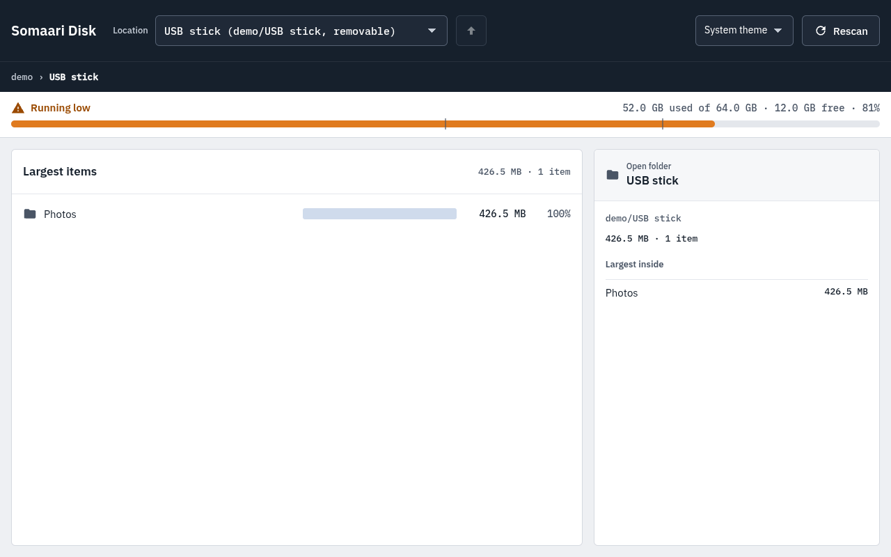
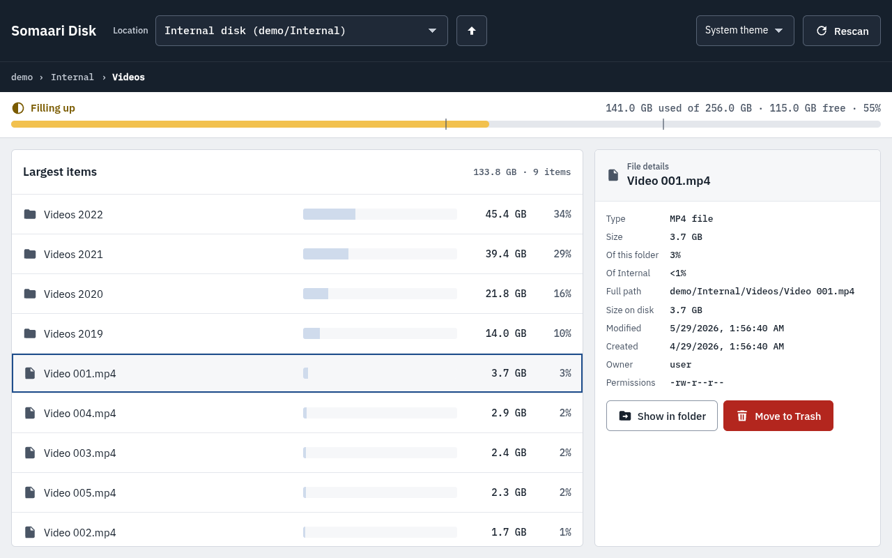
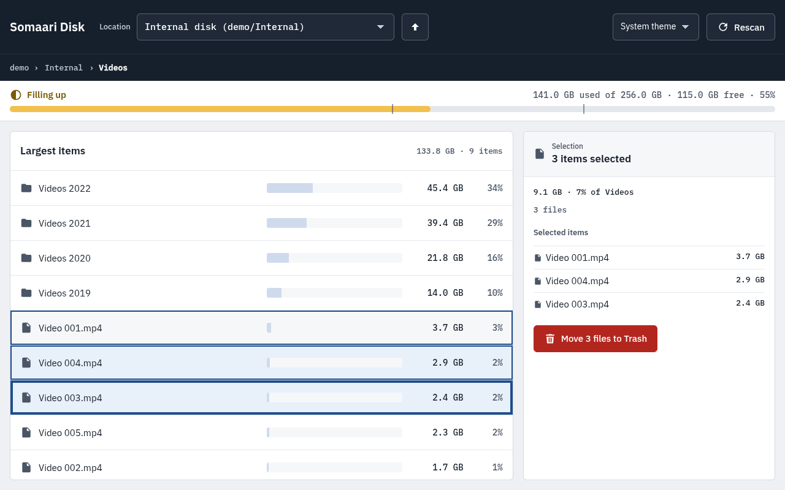
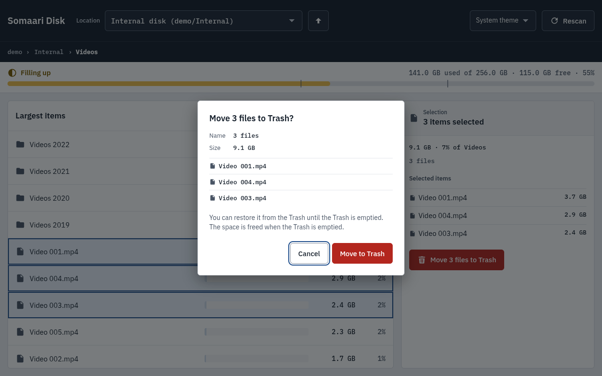

<div align="center">


<br>

**The somaari-disk guide: install it, set it up, and find what is filling your drives.**<br>
For what it does and doesn't do, privacy, safety and development, see the [README](../README.md).

<br>

[Installation](#-installation) ·
[Configuration](#%EF%B8%8F-configuration) ·
[Using the app](#-using-the-app) ·
[Troubleshooting](#-troubleshooting) ·
[README](../README.md)

</div>


> [!NOTE]
> All screenshots use the built-in demo tree (`--demo`), not real files.

<details>
<summary><b>Contents</b></summary>

<br>

- 🚀 [Installation](#-installation): [Requirements](#requirements) ·
  [Debian, Ubuntu, Raspberry Pi OS](#debian-ubuntu-raspberry-pi-os-deb) ·
  [Windows](#windows-installer-or-zip) · [Checking downloads](#checking-downloads) ·
  [From source on Linux](#from-source-on-linux) · [From source on Windows](#from-source-on-windows) ·
  [Updating](#updating) · [Try it with demo data](#try-it-with-demo-data) ·
  [Uninstalling](#uninstalling)
- ⚙️ [Configuration](#%EF%B8%8F-configuration): [Theme](#theme) ·
  [Window size and position](#window-size-and-position) ·
  [Where the app keeps its files](#where-the-app-keeps-its-files) ·
  [Command line](#command-line)
- 🧭 [Using the app](#-using-the-app): [The screen](#the-screen) ·
  [Choosing a location](#choosing-a-location) · [The usage bar](#the-usage-bar) ·
  [Largest items](#largest-items) · [File and folder details](#file-and-folder-details) ·
  [Selecting several items](#selecting-several-items) · [Move to Trash](#move-to-trash) ·
  [Rescan and saved scans](#rescan-and-saved-scans) · [Keyboard](#keyboard) ·
  [What it skips](#what-it-skips)
- 🩺 [Troubleshooting](#-troubleshooting) · [Reporting a problem](#reporting-a-problem)

</details>

---

## 🚀 Installation

### Requirements

| System | Needs |
|---|---|
| 🐧 **Debian 12+, Ubuntu 23.04+, Raspberry Pi OS Bookworm** (arm64 or x86-64) | Python 3.11 or newer, GTK and WebKitGTK (the `.deb` pulls them in) |
| 🪟 **Windows 10 (1803+) or 11**, 64-bit Intel or AMD | The Microsoft Edge WebView2 Runtime (Windows 11 has it; see [Windows](#windows-installer-or-zip)) |
| 🐧 **Other Linux** (Fedora, Arch, …) | Install [from source](#from-source-on-linux) |

The app itself is small; from source it needs about 200 MB of disk space. A scan of a million
files uses roughly 250 to 300 MB of RAM.

Download release builds from
[Releases](https://github.com/ashwinkrpi/somaari-disk/releases).

### Debian, Ubuntu, Raspberry Pi OS (.deb)

One package for arm64 and x86-64, `somaari-disk_<version>_all.deb`:

```sh
sudo apt install ./somaari-disk_<version>_all.deb
```

Then open **Somaari Disk** from the app menu, or run `somaari-disk`. Installing a newer `.deb` the
same way replaces the old version; you don't need to uninstall first.

### Windows (installer or zip)

- **Installer:** `somaari-disk-<version>-setup.exe` installs for your user only and needs no admin
  rights. It adds a Start menu entry.
- **Portable:** `somaari-disk-<version>-windows-x64.zip`. Unpack it anywhere (a USB stick works)
  and run `somaari-disk\somaari-disk.exe`.

> [!IMPORTANT]
> **SmartScreen warning:** builds are not code signed yet, so Windows may say it "protected your
> PC". Choose **More info**, then **Run anyway**. Check the download first
> ([Checking downloads](#checking-downloads)).

The window uses **Microsoft Edge WebView2**. Windows 11 includes it, and Windows Update installs it
on most Windows 10 PCs. Older or un-updated Windows 10 PCs and LTSC editions may not have it: if the
app says WebView2 is missing, install the **Evergreen Bootstrapper** from Microsoft's WebView2
download page, then start the app again. The installer does not include WebView2.

### Checking downloads

Every release has a `SHA256SUMS` file. Compare it with your download:

```sh
sha256sum -c SHA256SUMS --ignore-missing     # Linux
```

```powershell
Get-FileHash .\somaari-disk-<version>-setup.exe   # Windows: compare with the line in SHA256SUMS
```

### From source on Linux

For other distributions, or to run the latest code. The window uses GTK and WebKitGTK from your
distribution, and they must match the system Python, so use the distribution's own `python3`, not
one from pyenv, conda or a PPA.

| Distribution | Python | Status |
|---|---|---|
| Raspberry Pi OS / Twister OS (Bookworm, 64-bit) | 3.11 | Main test platform |
| Debian 12 or newer | 3.11+ | Expected to work |
| Ubuntu 24.04 or newer (also Mint 22, Pop!_OS 24.04) | 3.12+ | Expected to work |
| Fedora 39 or newer | 3.12+ | Expected to work |
| Arch, Manjaro | current | Expected to work |
| Ubuntu 22.04, Debian 11 and older | 3.10 or older | Not supported (Python too old) |

Check your Python version with `python3 --version`.

**1. System packages**

```sh
# Debian, Ubuntu, Raspberry Pi OS, Mint
sudo apt update
sudo apt install git python3-venv python3-gi python3-gi-cairo gir1.2-gtk-3.0 gir1.2-webkit2-4.1

# Fedora
sudo dnf install git python3 python3-gobject gtk3 webkit2gtk4.1

# Arch, Manjaro
sudo pacman -S git python python-gobject gtk3 webkit2gtk-4.1
```

**2. Get the code and set it up**

```sh
git clone https://github.com/ashwinkrpi/somaari-disk.git
cd somaari-disk
python3 -m venv --system-site-packages .venv
.venv/bin/pip install -e ".[dev]"
```

`--system-site-packages` is required: it lets the app use the PyGObject from step 1. Without it,
the window cannot open.

**3. Run it**

```sh
.venv/bin/python -m somaari_disk
```

From an SSH session into a machine with a desktop, put `DISPLAY=:0` in front of that command.

### From source on Windows

**1. Python and Git.** Install Python 3.12 from python.org and tick **Add python.exe to PATH**
(or `winget install Python.Python.3.12`), and Git from git-scm.com (or `winget install Git.Git`).
Close and reopen PowerShell, then check `py -3.12 --version`. Python 3.12 is recommended because
the window library's Windows parts (pythonnet) publish wheels for it; use 3.11 if 3.12 isn't
available. WebView2 is needed here too (see [Windows](#windows-installer-or-zip)).

**2. Get the code and set it up** (PowerShell, no admin rights needed):

```powershell
git clone https://github.com/ashwinkrpi/somaari-disk.git
cd somaari-disk
py -3.12 -m venv .venv
.venv\Scripts\python -m pip install --upgrade pip
.venv\Scripts\pip install -e ".[dev]"
```

You don't need to "activate" the venv, so PowerShell's script execution policy doesn't matter.

**3. Run it** as a normal user, not "Run as administrator":

```powershell
.venv\Scripts\python -m somaari_disk
```

### Updating

- **.deb:** download the new release and `sudo apt install ./somaari-disk_<version>_all.deb`.
- **Windows:** run the new installer, or replace the unpacked folder with the new zip's.
- **From source:** `git pull`, then run the install command from step 2 again
  (`.venv/bin/pip install -e ".[dev]"`, or `.venv\Scripts\pip …` on Windows).

Your theme, window size and saved scans are kept.

### Try it with demo data

```sh
somaari-disk --demo        # or: .venv/bin/python -m somaari_disk --demo
```

Opens the window on two generated drives ("Internal disk" and "USB stick") instead of your real
ones. Nothing is read from or written to your disks, and demo scans are never saved. Use this for
screenshots and bug reports.

### Uninstalling

- **.deb:** follow [UNINSTALL.md](../UNINSTALL.md). A script removes the package, leftovers and app
  data in one step, or you can do it by hand.
- **Windows installer:** **Settings → Apps**, find Somaari Disk, **Uninstall**. **Zip:** delete the
  folder.
- **Source checkout:** delete the folder you cloned.

To also remove settings and saved scans, delete the folders in
[Where the app keeps its files](#where-the-app-keeps-its-files). On Linux, the system packages from
step 1 are shared with other apps; leave them installed unless you know nothing else uses them.

---

## ⚙️ Configuration

There is no settings file to edit. The app remembers three things by itself.

### Theme


The theme menu in the top bar has **System theme** (default: follows your OS light/dark setting,
and switches when the OS does), **Light** and **Dark**. Your choice is saved in `prefs.json`.

### Window size and position

The window opens where you left it: size, position and maximized state are saved in `window.json`
when you close it. If a saved position is off every current screen (for example after unplugging a
monitor), the app opens at the default size, centred, instead.

> [!TIP]
> Window stuck off-screen or too big? Start it once with `somaari-disk --reset-window`. It forgets
> the saved size and position.

On Wayland the position isn't restored (Wayland doesn't let apps place their windows); the size is.

### Where the app keeps its files

| | Linux | Windows |
|---|---|---|
| Settings (`prefs.json`, `window.json`) | `~/.config/somaari-disk/` | `%LOCALAPPDATA%\somaari-disk\somaari-disk\` |
| Log | `~/.config/somaari-disk/logs/app.log` | `%LOCALAPPDATA%\somaari-disk\somaari-disk\logs\app.log` |
| Saved scans | `~/.cache/somaari-disk/scans/` | `%LOCALAPPDATA%\somaari-disk\somaari-disk\Cache\scans\` |

- The **log** replaces your home folder with `~`, never contains file names, and keeps at most 4
  files of 512 KiB.
- **Saved scans** hold the last scan of up to 8 locations. They list real file names, so on Linux
  the folder is readable only by you. Delete it any time; the app just scans again.

### Command line

| Command | What it does |
|---|---|
| `somaari-disk` | Opens the window |
| `somaari-disk --demo` | The window with generated sample drives ([Try it with demo data](#try-it-with-demo-data)) |
| `somaari-disk --reset-window` | Forgets the saved window size and position, then opens |
| `somaari-disk --debug` | The window with web developer tools enabled |
| `somaari-disk scan <folder>` | Prints the largest items in that folder, no window |
| `somaari-disk volumes` | Lists drives with size, file system and flags (removable, read-only, network) |

From source, use `.venv/bin/python -m somaari_disk` (Windows: `.venv\Scripts\python -m somaari_disk`)
in place of `somaari-disk`. Flags can be combined, e.g. `--demo --reset-window`.

---

## 🧭 Using the app

### The screen

| Part | What's there |
|---|---|
| **Top bar** | **Location** (which drive or folder to scan), **Up** (one folder up), the theme menu and **Rescan** (or **Stop** while scanning). Below it, the breadcrumb: where you are inside the location |
| **Usage bar** | How full the drive is: a label, used / total / free, and the percentage |
| **Largest items** | What's in the open folder, biggest first, with a bar and its share of the folder |
| **Side panel** (right) | Details for the open folder, the selected item, or several selected items, with the actions |

### Choosing a location

On start the app opens your **Home folder** (or the system drive). Pick something else from
**Location**: every drive the system has mounted is listed, internal disks and external ones (USB
sticks and drives, SD cards, NVMe), with removable and read-only drives marked. Plug a drive in or
out while the window is open and the list updates within a few seconds.

On Linux, a USB or SD card partition that nothing has mounted yet is listed as **not mounted,
removable**. Picking it mounts it, the same way the file manager does (no password), and scans it.
Internal disks that aren't mounted aren't listed.

Network shares are listed too; one that doesn't answer within 2 seconds shows with zero size.

### The usage bar



| Label | Used |
|---|---|
| **Plenty of space** | under 50% |
| **Filling up** | 50 to 75% |
| **Running low** | 75% and more |
| **Disk full** | 100%, or no free space left |

Each level has its own icon and label, not just a colour. The two tick marks are at 50% and 75%.
When you scan a folder rather than a whole drive (Home folder), the line under the bar says how
much of the drive that folder takes.

### Largest items

The list shows the open folder's contents, biggest first: name, a bar, size and share of the
folder. Small leftovers are rolled up into one **Other (N items)** row.

- **Click** a row to select it and see its details on the right.
- **Double-click** a folder (or press **Enter**) to open it. **Up**, **Backspace**, **Alt+Up** or
  the breadcrumb go back.
- Tags after a name: **No access** (the app wasn't allowed to read it), **Unreadable**, **Other
  drive** (another drive is mounted there; it isn't counted).

While a scan runs, the list fills in and the numbers grow; you can already browse.

### File and folder details



Select a file to see its type, size, share of the folder and of the whole location, full path,
size on disk, modified and created dates, owner and permissions. With nothing selected, the panel
shows the open folder and its largest items.

**Show in folder** opens your file manager (Explorer on Windows) at that item, with the file
selected where the file manager supports it.

### Selecting several items



Like a desktop file manager: **Ctrl+click** adds or removes a row, **Shift+click** selects a range,
**Ctrl+A** selects everything in the folder. The side panel lists the selected items with their
total size and offers **Move N files to Trash** for all of them at once. **Esc** goes back to one
row.

### Move to Trash



The only change the app ever makes to your files. Press **Move to Trash** in the side panel (or
the **Delete** key) and confirm in the dialog, which names the items and their size. **Cancel** is
focused first, and **Esc** cancels.

- Items go to the system **Trash** (Linux) or **Recycle Bin** (Windows) and can be restored from
  there. There is no permanent delete. The space is only freed when the Trash is emptied.
- Folders can be trashed too; the dialog warns that everything inside goes with them. A folder that
  holds another drive is refused.
- Totals update right away, without a rescan.
- When an item can't be trashed, the button is disabled and says why (read-only drive, the scan is
  still running, it's the location itself). If moving fails, the app says why in plain words (no
  permission, no Trash on that drive, drive unplugged, already gone).

### Rescan and saved scans

The app remembers the last complete scan of each location. Choosing a location opens its saved
scan instantly, with a notice: *Showing the last scan, from &lt;date&gt;*. **Rescan** (or **F5**)
scans fresh. **Stop** (or **Esc**) ends a scan early; the notice then says sizes are incomplete.

A drive keeps its saved scan when you unplug it and plug it in again, even into another port. If
a drive disappears mid-scan, the app shows **Drive disconnected** and keeps what it had.

### Keyboard

Everything works without a mouse.

| Keys | Action |
|---|---|
| ↑ ↓, Home / End, PgUp / PgDn | Move in the list |
| Enter | Open the selected folder |
| Backspace or Alt+↑ | Up one folder |
| Shift+↑ / ↓ | Select a range |
| Ctrl+↑ / ↓, then Ctrl+Space | Move without selecting, then add or remove that row |
| Space | Select only the focused row |
| Ctrl+A | Select all · **Esc** back to one |
| Delete | Move the selected items to Trash (asks first). In the dialog, ← / → switch between Cancel and Move to Trash; Esc cancels |
| Tab | Move between controls |
| F6 / Shift+F6 | Jump between the top bar, the list and the side panel |
| ← / → | Move between the side panel's buttons and along the breadcrumb |
| F5 / Esc | Rescan / stop a scan |

### What it skips

- **Symbolic links and junctions** are never followed, so nothing is counted twice and a scan can't
  wander off.
- **Other drives** mounted inside a location aren't scanned (tagged **Other drive**).
- **Hard links** are counted once.
- **Folders it can't read** (system folders, other users' files) are skipped and tagged **No
  access**; the scan keeps going.
- **OneDrive online-only files** are not downloaded; they show 0 size on disk.

---

## 🩺 Troubleshooting

**Starting the app**

<details>
<summary><b>Linux: <code>No module named 'gi'</code></b></summary>

The venv was made without `--system-site-packages`, or with a different Python than the system
one. Delete `.venv` and redo step 2 of [From source on Linux](#from-source-on-linux) with the
system `python3`.
</details>

<details>
<summary><b>Linux: <code>Namespace WebKit2 not available</code></b></summary>

Install `gir1.2-webkit2-4.1` (Fedora: `webkit2gtk4.1`, Arch: `webkit2gtk-4.1`).
</details>

<details>
<summary><b>Linux: the window opens but stays blank or flickers</b></summary>

A graphics driver issue in WebKitGTK. Start the app with `WEBKIT_DISABLE_DMABUF_RENDERER=1` in
front of the command. On Wayland, also try `GDK_BACKEND=x11`.
</details>

<details>
<summary><b>Linux, over SSH: <code>cannot open display</code></b></summary>

Put `DISPLAY=:0` in front of the command, and stay logged in to the desktop.
</details>

<details>
<summary><b>Windows: a dialog says WebView2 is missing</b></summary>

Install the Evergreen WebView2 Runtime; see [Windows](#windows-installer-or-zip).
</details>

<details>
<summary><b>Windows: "Windows protected your PC"</b></summary>

SmartScreen, because the builds aren't code signed. Choose **More info**, then **Run anyway**.
</details>

<details>
<summary><b>Windows, from source: <code>py</code> is not recognized, or an error about pythonnet or <code>clr</code></b></summary>

Reinstall Python with **Add python.exe to PATH** ticked, or use the full path to `python.exe`. For
pythonnet errors use Python 3.12, and make sure .NET Framework 4.7.2 or newer is installed (it is
on current Windows 10 and 11).
</details>

<details>
<summary><b>The window opens off-screen, too big, or in the wrong place</b></summary>

Start once with `--reset-window`; see [Window size and position](#window-size-and-position).
</details>

**Drives and scans**

<details>
<summary><b>A drive is missing from Location</b></summary>

Empty card readers and DVD drives aren't listed. Give a newly plugged drive a few seconds. On
Windows, drives mounted in a folder (without a drive letter) aren't listed.
</details>

<details>
<summary><b>"No access" on some folders</b></summary>

Expected for system folders and other users' files. The scan skips them and keeps going. Running
as administrator or root is not needed or recommended.
</details>

<details>
<summary><b>Sizes look old</b></summary>

You're looking at a saved scan (the notice shows its date). Press **Rescan**.
</details>

<details>
<summary><b>Free space didn't grow after Move to Trash</b></summary>

The space is freed when the Trash or Recycle Bin is emptied.
</details>

<details>
<summary><b>Move to Trash is disabled</b></summary>

The button says why: the drive is read-only (or an SD card's lock switch is on), the scan is still
running, or the item is the location itself.
</details>

### Reporting a problem

Open an issue on GitHub and include:
- the OS and version, the CPU type (x86-64 or ARM), the app version, and the Python version when
  running from source
- the drive type (internal, USB, SD card or network) and its file system
- what you did, what you expected, and what happened
- the last lines of the log ([Where the app keeps its files](#where-the-app-keeps-its-files))

> [!WARNING]
> Never include real file names, folder names or paths, in text or screenshots. Describe them
> instead ("a folder with an emoji in its name"), or reproduce the problem with `--demo`.
> Security problems go privately through [SECURITY.md](../SECURITY.md), not in an issue.

<div align="center">
<br>
<sub>Back to the <a href="../README.md">README</a>.</sub>
</div>
