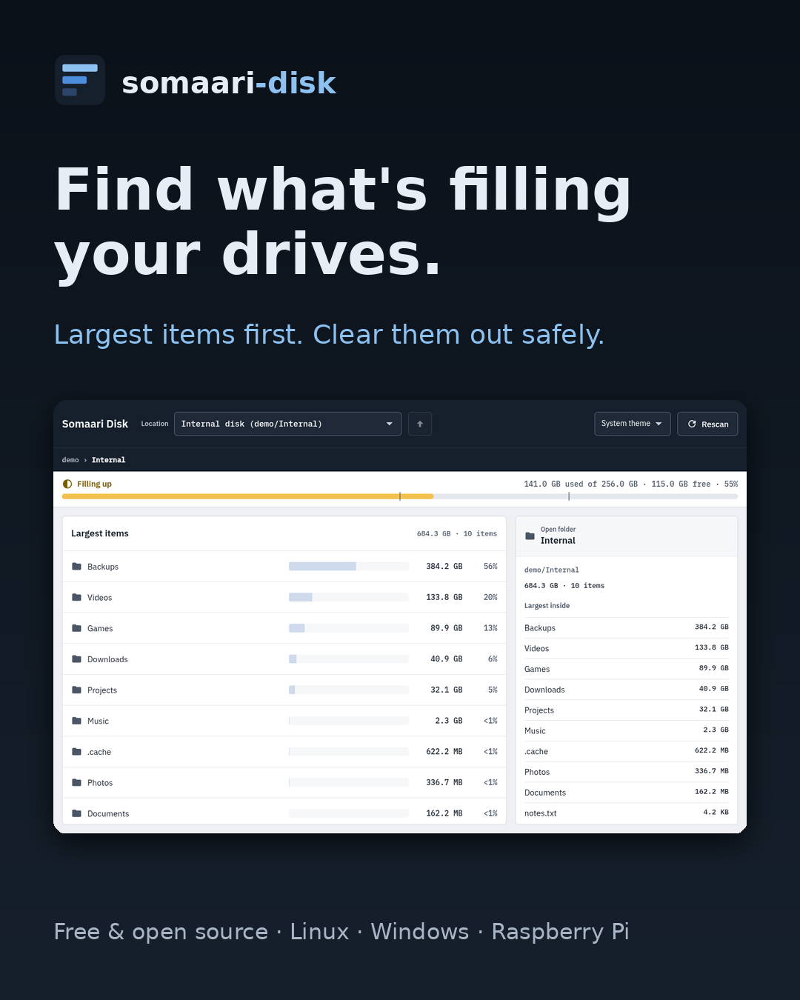
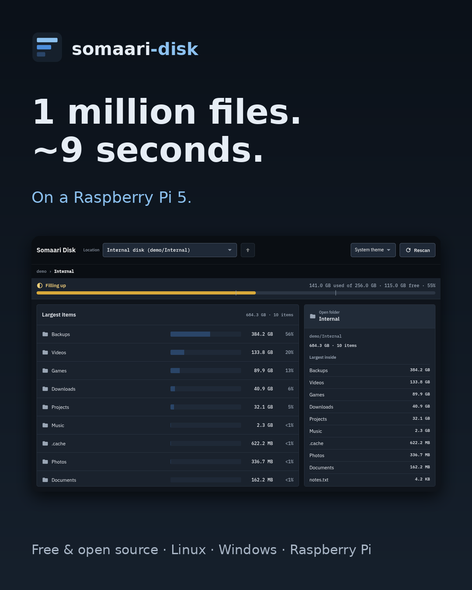
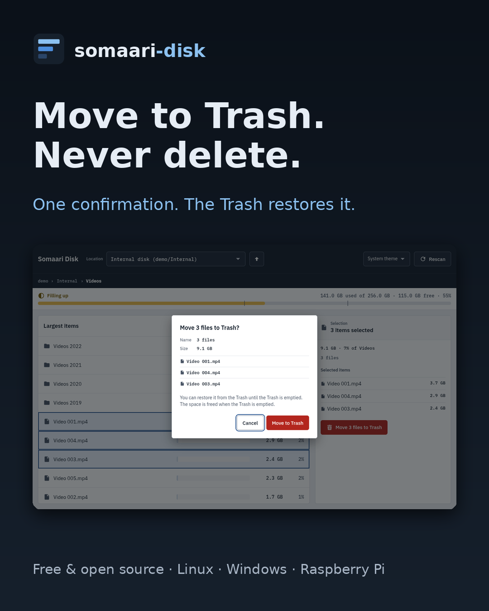
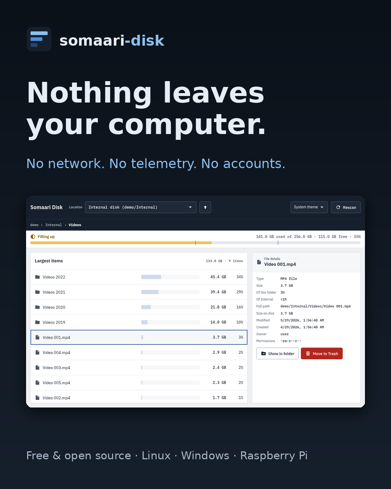
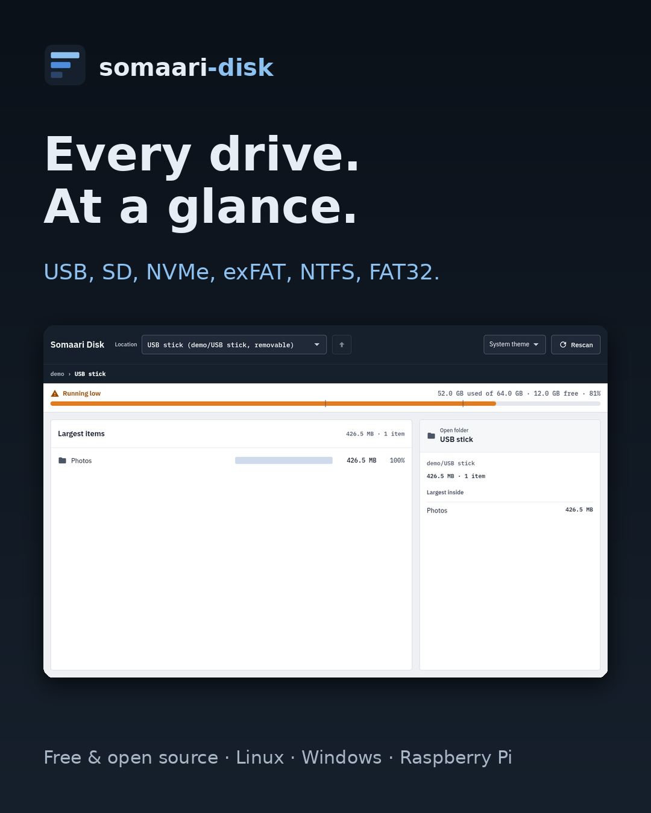

# Somaari Disk: Instagram posts

Each image is 1080 × 1350 (4:5 portrait, Instagram's tallest feed size). Upload the image, then paste the caption. Instagram doesn't make links in captions clickable, so the captions say "link in bio": put `https://github.com/ashwinkrpi/somaari-disk` in your bio.

## Suggested schedule (Bangalore, IST)

**How often:** 2 feed posts a week, on Wednesday and Friday evenings, 25 Nov to 9 Dec. Each one goes out the day after the same topic appears on LinkedIn (9:00 AM) and X (9:00 PM). That way people see the topic twice, and Instagram gets its best weekday evening slot. The posts below are in their original order. Post them on the dates in this table. Share each new post to your Story the same day, and add Stories on other days too (screen recordings of a scan work well). Stories keep you visible without crowding your feed.

**Best times (IST)**
- **7:00 to 9:00 PM, weekdays:** the best slot. People scroll after work and dinner.
- **12:30 to 2:00 PM, weekdays:** the lunch break.
- **10:00 AM to 12:00 PM, Sat and Sun:** weekend mornings do better on Instagram than on X.
- **Avoid:** late night (after 11 PM) and early morning (before 8 AM).

| Date | Time (IST) | Post | Same topic on LinkedIn + X |
|------|------------|------|-----------------------------|
| Wed 25 Nov | 7:30 PM | Post 1: Meet Somaari Disk | Tue 24 Nov |
| Fri 27 Nov | 7:30 PM | Post 3: Safety | Thu 26 Nov |
| Wed 2 Dec | 7:30 PM | Post 5: Every drive | Tue 1 Dec |
| Fri 4 Dec | 7:30 PM | Post 4: Privacy | Thu 3 Dec |
| Wed 9 Dec | 7:30 PM | Post 2: Speed | Tue 8 Dec |

Put the GitHub link in your bio by **Mon 23 Nov**, before the first post.

**Tips**
- Instagram always goes out the day after LinkedIn and X, so each day you're answering comments on only one or two platforms.
- Reply to every comment within the first hour.
- To schedule posts, use Meta Business Suite (free). It needs a Professional (Creator or Business) account.
- After the last post, check Insights → Audience → Most active times and adjust.

---

## Post 1: Meet Somaari Disk (Wed 25 Nov, 7:30 PM)



**Image:** `images/instagram/1-main-light.png`

```
Drive full again? 😩

Somaari Disk shows you what's actually taking up the space, with the biggest items at the top.

📊 Largest items first, with a size bar for each
📂 Double-click a folder to look inside
🗑️ Clear things out safely with Move to Trash

Free and open source for Linux, Windows and Raspberry Pi.
🔗 Link in bio

#opensource #linux #windows #raspberrypi #productivity #techtools #diskspace #freesoftware
```

---

## Post 2: Speed (Wed 9 Dec, 7:30 PM)



**Image:** `images/instagram/2-main-dark.png`

```
1,000,000 files in about 9 seconds ⚡
On a Raspberry Pi 5.

Somaari Disk fills the list while it scans, so you see the big folders right away. It also saves every scan, so the next time it opens instantly.

Light mode, dark mode, or match your system 🌗

🔗 Link in bio

#raspberrypi #raspberrypi5 #linux #opensource #python #homelab #makers #techtips
```

---

## Post 3: Safety (Fri 27 Nov, 7:30 PM)



**Image:** `images/instagram/3-trash-dialog.png`

```
A disk cleaner that won't wreck your disk 🛡️

✅ It only reads your files
✅ The one change it can make is Move to Trash
✅ It always asks first
✅ You can restore anything from the Trash

No permanent delete. Ever.

🔗 Link in bio

#opensource #datasafety #linux #windows #techtools #productivity #freesoftware
```

---

## Post 4: Privacy (Fri 4 Dec, 7:30 PM)



**Image:** `images/instagram/4-file-details.png`

```
Nothing leaves your computer 🔒

🚫 No internet connection
🚫 No telemetry
🚫 No account

Click any file to see its type, size, size on disk, dates and owner, all without anything going online.

🔗 Link in bio

#privacy #privacymatters #opensource #linux #windows #noTracking #freesoftware
```

---

## Post 5: Every drive (Wed 2 Dec, 7:30 PM)



**Image:** `images/instagram/5-running-low.png`

```
Every drive, at a glance 💽

USB sticks, SD cards, NVMe, external drives. Plug one in and it shows up within seconds.

Works with exFAT, NTFS, FAT32, ext4 and read-only drives.

🟢 Plenty of space → 🟡 Filling up → 🟠 Running low → 🔴 Disk full

Download free 👉 link in bio

#usb #sdcard #storage #linux #windows #raspberrypi #opensource #techtools
```
