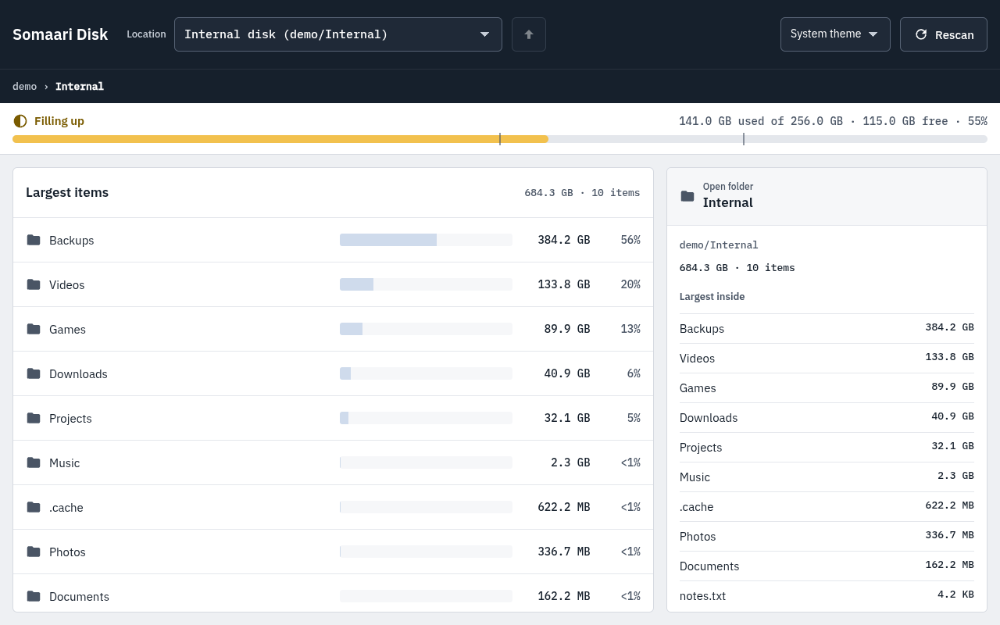
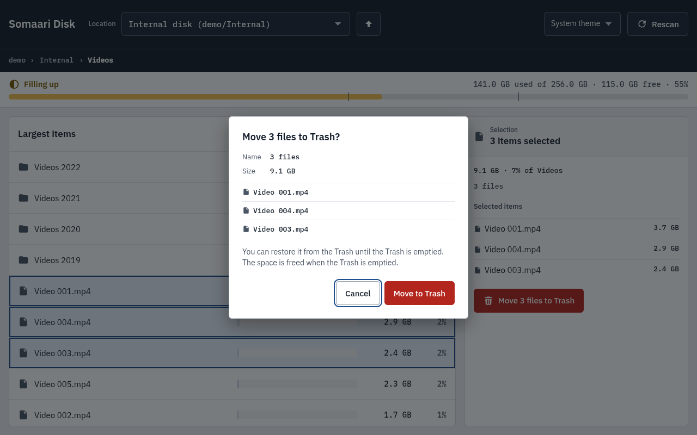
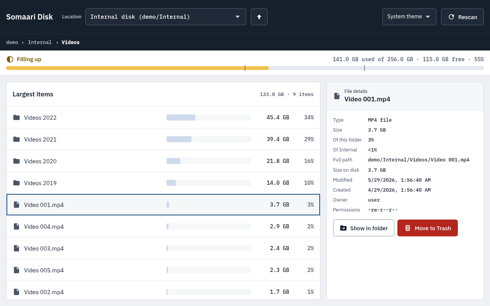
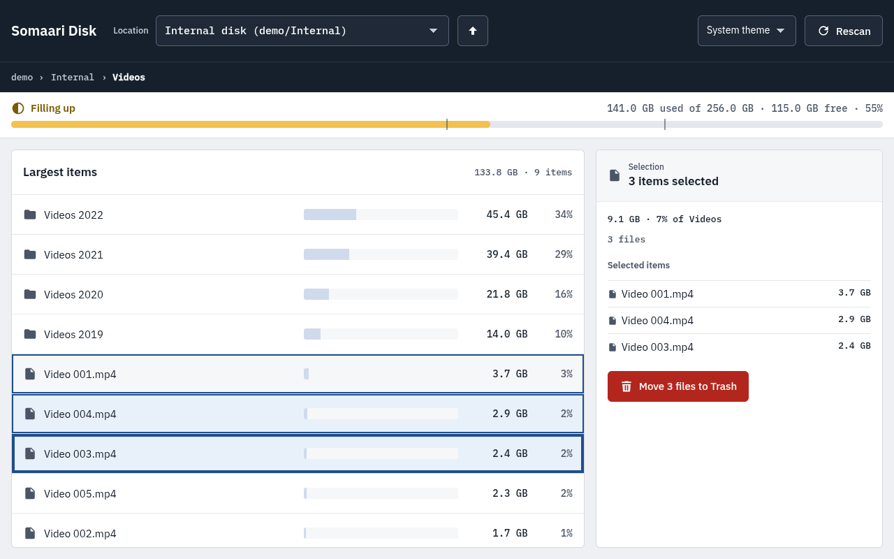
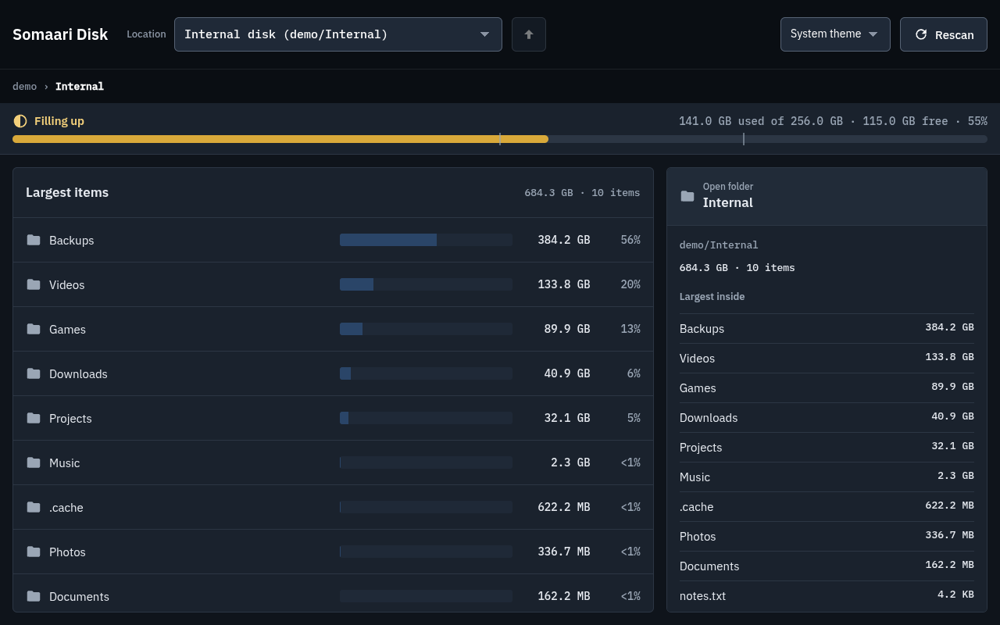

# Somaari Disk: LinkedIn posts

These 5 posts are already **scheduled in Supergrow** with their images attached, so you don't need to copy and paste them. This file is a record of what will go out. To change a post, use its "Edit" link. Changes made in Supergrow won't show up in this file.

The posts are written in your Supergrow Content DNA style: plain prose, no emojis or bullet points, a lesson from banking, and a closing question. LinkedIn shows posts with links to fewer people, so the GitHub link goes in an automatic first comment instead of the post itself.

## Schedule (Bangalore, IST)

**How often:** 2 posts a week, on Tuesday and Thursday at 9:00 AM. These are the same slots your current LinkedIn posts use. Weekday mornings work best on LinkedIn, because people read it at the start of the workday.

Your somaari.in posts already fill the slots up to 17 Nov, so these start on 24 Nov.

**Across platforms:** each LinkedIn post starts a "theme day". The same topic goes out on X at 9:00 PM that day and on Instagram at 7:30 PM the next day. See the tables in `twitter-posts.md` and `instagram-posts.md`.

| # | Post | Day | Date | Time (IST) | Image |
|---|------|-----|------|------------|-------|
| 1 | Launch: "Disk full" | Tue | 24 Nov 2026 | 9:00 AM | main-light |
| 2 | No delete button | Thu | 26 Nov 2026 | 9:00 AM | trash-dialog |
| 3 | Honest numbers | Tue | 1 Dec 2026 | 9:00 AM | file-details |
| 4 | Logs are data | Thu | 3 Dec 2026 | 9:00 AM | multi-select |
| 5 | 2 GiB on a shared Pi | Tue | 8 Dec 2026 | 9:00 AM | main-dark |

**Tips**
- Reply to every comment in the first hour. Early replies help a LinkedIn post reach more people.
- Post 1 gets an automatic first comment with the GitHub link, 2 minutes after it goes live.

---

## Post 1: Launch (Tue 24 Nov, 9:00 AM)

Preview: https://pub.supergrow.ai/public/posts/09bb098a-ebad-40d1-9b19-f9029d88869d ·
[Edit](https://app.supergrow.ai/write?post_id=7c009873-4f3f-4bb1-967b-220768c647ea&workspace_id=91efcfaf-f26f-4986-861f-9db6b3fca620)



```
"Disk full" tells you what happened. It doesn't tell you why.

My Raspberry Pi 5 runs several of my apps at once, and like any shared machine, it fills up. The usual way to find the cause is a terminal, a few du commands and some guesswork.

So I built Somaari Disk. It scans a drive or folder and lists the largest items first, with a usage bar and folder totals. It works the same on an internal disk, a USB stick or an SD card, on Linux and Windows.

The scanning was the easy part. The hard part was making sure the numbers were honest, and that a tool built for cleaning up could never permanently delete anything.

Free and open source — no AI at runtime, no network calls, no account required.

Built solo, and tested on the same Pi it was written for.

Link in the first comment. If you run a home server, what usually fills yours first?
```

**First comment (posts automatically after 2 minutes):**
```
Somaari Disk on GitHub (.deb for Debian, Ubuntu and Raspberry Pi OS, plus a Windows installer): https://github.com/ashwinkrpi/somaari-disk/releases
```

---

## Post 2: No delete button (Thu 26 Nov, 9:00 AM)

Preview: https://pub.supergrow.ai/public/posts/ade13fdb-9901-4432-babe-00062b25333e ·
[Edit](https://app.supergrow.ai/write?post_id=10dbad9e-1d26-414f-a207-18c16b1fbf89&workspace_id=91efcfaf-f26f-4986-861f-9db6b3fca620)



```
A disk cleanup tool has one dangerous feature: the delete button.

In Somaari Disk, there isn't one.

The app only reads your files. The single change it can make is Move to Trash, after you confirm, and the Trash gives it back. No permanent delete anywhere in the code.

That rule came straight from banking. Production access is read-only by default, and every write path is narrow, named and confirmed. Not because people are careless, but because one click on the wrong folder is expensive to undo.

A personal utility deserves the same rule. The person running it at 11 PM, trying to free 20 GB, is exactly the person who will click the wrong thing.

If you're building anything that touches someone's files, count the ways it can destroy data. Does each one need to exist?
```

---

## Post 3: Honest numbers (Tue 1 Dec, 9:00 AM)

Preview: https://pub.supergrow.ai/public/posts/56f71c36-97fe-4b80-9748-952218d35ba3 ·
[Edit](https://app.supergrow.ai/write?post_id=5b8e34a9-1a64-4a34-907e-6234f5f2118e&workspace_id=91efcfaf-f26f-4986-861f-9db6b3fca620)



```
Disk usage sounds like simple arithmetic. Add up the file sizes. Done.

Then the edge cases arrive. A symlink that points back at its own parent and counts a folder twice, or forever. A hard link that makes one file look like three. A USB drive mounted inside your home folder, quietly added to your home total.

Every one of those produces a number. No error. No warning. Just wrong.

Somaari Disk never follows symlinks or junctions, stays on one drive unless you ask, counts hard links once, and shows size on disk next to file size.

It's the same lesson as reconciling a data migration: a total that adds up is not the same as a total that's correct.

What's the most convincing wrong number you've seen a system produce?
```

---

## Post 4: Logs are data (Thu 3 Dec, 9:00 AM)

Preview: https://pub.supergrow.ai/public/posts/f933c4ab-68b7-4ba6-90c1-2e3859243464 ·
[Edit](https://app.supergrow.ai/write?post_id=d901ec04-f0fd-48c2-be71-db7a44dd5831&workspace_id=91efcfaf-f26f-4986-861f-9db6b3fca620)



```
A file name can say more than the file.

Somaari Disk keeps a log, as any app should. What goes into it is counts, timings and error codes. Never file names. Your home folder is written as ~, so even the path doesn't point back to you.

The app makes no network requests. No telemetry, no account. The page inside the window loads only its own bundled files.

In banking we treat logs as data, because they are. They get copied, shipped and kept far longer than anyone planned. Whatever is in them ends up in places nobody audits.

Solo projects skip this because nobody asks. Nobody asked me either.

Worth opening the log folder of your own app tonight and reading what it actually writes down.
```

---

## Post 5: 2 GiB on a shared Pi (Tue 8 Dec, 9:00 AM)

Preview: https://pub.supergrow.ai/public/posts/09e712f2-d245-4fab-83a3-d9f7636b6d7a ·
[Edit](https://app.supergrow.ai/write?post_id=cc6ebb23-8d33-4721-b4db-fd5e02d25c39&workspace_id=91efcfaf-f26f-4986-861f-9db6b3fca620)



```
The Raspberry Pi I build on has about 2 GiB of memory to spare. The first version of my disk scanner used most of it.

Other services share that Pi, so anything new has to fit in what's left. On a generated tree of a million files, Somaari Disk took 44.5 seconds and 1.55 GiB.

Two changes fixed it. Limit how many folder listings run at once, and stop storing the same file name over and over within a scan.

Same million files: 8.9 seconds, 527 MiB.

Neither fix was clever. Both came from measuring on the hardware the app has to live on.

If your app runs fine on your laptop, have you tried it on the smallest machine your users might have?
```
