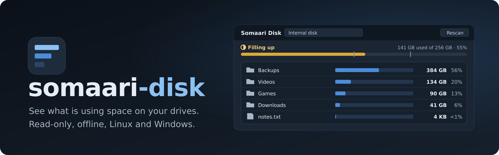
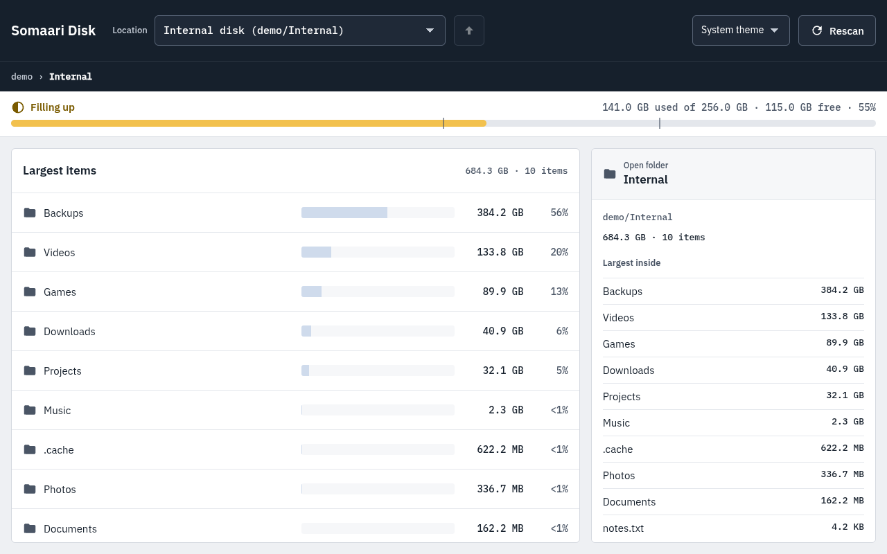
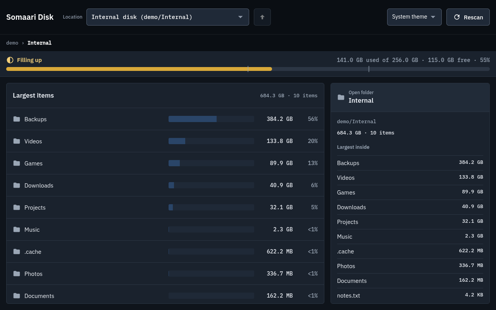
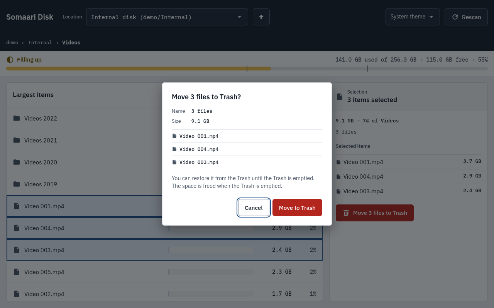
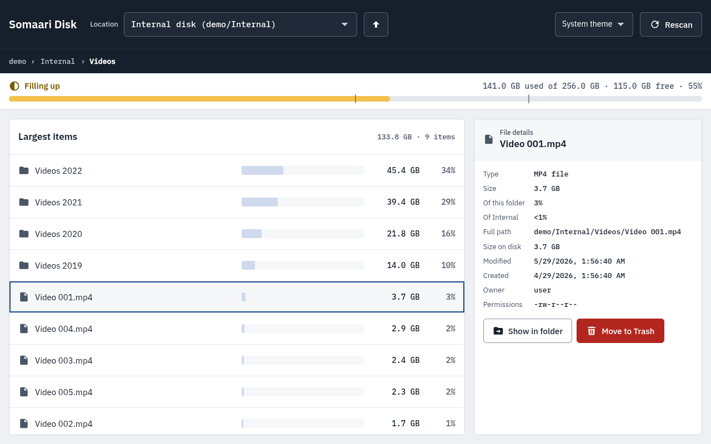
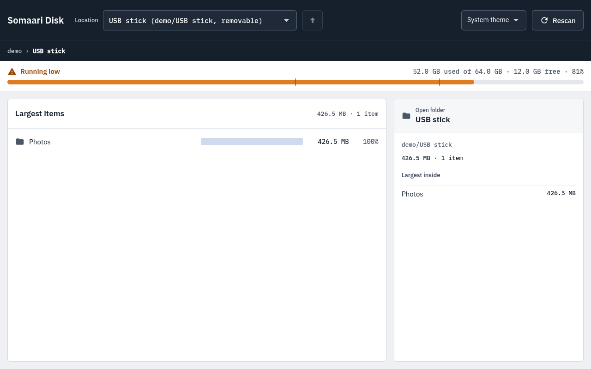

# Somaari Disk: Twitter / X posts

Copy the text inside each box and attach the image(s) listed under it. Every post fits in 280 characters (X counts a link as 23).

## Suggested schedule (Bangalore, IST)

**How often:** 2 posts a week, on Tuesday and Thursday evenings, 24 Nov to 8 Dec. On the days in between, reply to comments and join Raspberry Pi, Linux and open-source threads. Replies grow a new account faster than more posts do.

### How X, LinkedIn and Instagram fit together

Each topic gets its own "theme day": **LinkedIn in the morning, X the same evening, Instagram the next evening.**

1. **LinkedIn, 9:00 AM:** goes first. It's the longest version of the story, and weekday mornings are when LinkedIn gets read.
2. **X, 9:00 PM the same day:** the short version. This is X's best slot in India, and it's morning on the US East Coast, where much of the Linux and Raspberry Pi crowd is.
3. **Instagram, 7:30 PM the next day:** the visual recap, on Instagram's best weekday slot. Posting it a day later shows the topic to people twice, and you only reply to one platform at a time.

The posts below are in their original order. Post them on the dates in this table.

**Best times (IST)**
- **8:30 to 10:00 PM, Mon to Fri:** the best slot. People in India are online in the evening, and it's 10:00 to 11:30 AM on the US East Coast, where much of the Linux and Raspberry Pi crowd is.
- **9:00 to 11:00 AM, Tue to Thu:** a good slot for Indian developers starting work.
- **Avoid:** Saturday and Sunday, and 1:00 to 6:00 AM.

| Date | Theme | LinkedIn (9:00 AM, fixed) | X (9:00 PM) | Instagram (next day, 7:30 PM) |
|------|-------|---------------------------|-------------|-------------------------------|
| Tue 24 Nov | Launch | Post 1: "Disk full" | **Post 1: Launch** (pin it) | Wed 25 Nov: Post 1 |
| Thu 26 Nov | Safety | Post 2: No delete button | **Post 3: Safety** | Fri 27 Nov: Post 3 |
| Tue 1 Dec | Drives & honest numbers | Post 3: Honest numbers | **Post 5: Every drive** | Wed 2 Dec: Post 5 |
| Thu 3 Dec | Privacy | Post 4: Logs are data | **Post 4: Privacy** | Fri 4 Dec: Post 4 |
| Tue 8 Dec | Speed on a Pi | Post 5: 2 GiB on a shared Pi | **Post 2: Speed** | Wed 9 Dec: Post 2 |

**Tips**
- Pin Post 1 to your profile.
- Stay around for 30 to 60 minutes after posting and reply to everyone. Early replies help a post reach more people.
- To schedule posts ahead of time, use the calendar icon in X's composer on the web.
- After the last post, check X Analytics and move to the times that worked best for you.

---

## Post 1: Launch (Tue 24 Nov, 9:00 PM)

```
Your drive is full. But what's filling it?

Somaari Disk scans any drive or folder and shows the biggest items first, so you can clear them out safely.

Free and open source, for Linux, Windows and Raspberry Pi.

https://github.com/ashwinkrpi/somaari-disk
```

**Images:** `images/twitter/1-banner.png`, `images/twitter/1-main-light.png`




---

## Post 2: Speed on a Raspberry Pi (Tue 8 Dec, 9:00 PM)

```
1 million files. About 9 seconds. On a Raspberry Pi 5.

Somaari Disk fills the list while it scans, so you see the biggest folders right away. Stop any time.

It saves each scan too, so the next time it opens instantly.

#RaspberryPi #Linux
```

**Image:** `images/twitter/2-main-dark.png`



---

## Post 3: Safety (Thu 26 Nov, 9:00 PM)

```
A disk cleaner that can't wreck your disk.

Somaari Disk only reads your files. The one thing it changes is Move to Trash: it asks first, and you can restore anything from the Trash.

No permanent delete. Ever.

https://github.com/ashwinkrpi/somaari-disk
```

**Image:** `images/twitter/3-trash-dialog.png`



---

## Post 4: Privacy (Thu 3 Dec, 9:00 PM)

```
Your file names are nobody's business.

Somaari Disk makes zero network requests. No telemetry, no account, no cloud. Everything stays on your computer.

Click any file to see its size, size on disk, dates and owner.

#privacy #opensource
```

**Image:** `images/twitter/4-file-details.png`



---

## Post 5: Every drive (Tue 1 Dec, 9:00 PM)

```
USB stick, SD card, NVMe, external HDD: plug it in and it shows up in Somaari Disk within seconds.

exFAT, NTFS, FAT32, ext4 and read-only drives all work.

It tells you "Running low" before you run out.

Download: https://github.com/ashwinkrpi/somaari-disk/releases
```

**Image:** `images/twitter/5-running-low.png`


